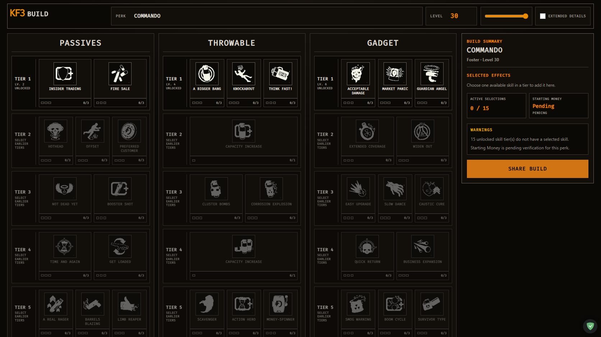

# Google Stitch starter project

Use Google Stitch to explore a visual direction before changing the SvelteKit app. Treat generated screens and code as references, not as production-ready replacements.

## Current design reference



This screenshot is the current implementation reference. Upload it to Stitch with the starter prompt when creating a new concept. Preserve its dark armory-terminal palette, three-tree layout, right-side Build Summary rail, tier states, compact skill cards, and interaction hierarchy unless the concept explicitly explores a documented alternative.

## Create the starter project

1. Read [`PRODUCT.md`](../PRODUCT.md) and the UI rules in [`AGENTS.md`](../AGENTS.md).
2. Open [Google Stitch](https://stitch.withgoogle.com/) and create a project from an image and text prompt.
3. Upload `docs/assets/kf3-current-design.png`, paste the starter prompt below, and generate the desktop screen first.
4. Ask Stitch for a mobile version of the same screen without changing its colors, information hierarchy, or interaction states.
5. Check both versions against the accessibility, responsive, and visual-approval requirements in `AGENTS.md`.
6. Export or copy useful design/code only as a reference. Adapt it to the existing SvelteKit components and domain helpers instead of replacing the app wholesale.

## Starter prompt

```text
Design a responsive starter interface for “KF3 Build,” a Killing Floor 3 perk skill-tree simulator.

The product should feel like a rugged, tactical armory terminal: decisive, compact, and highly legible. Do not use bright sci-fi neon, glassmorphism, oversized soft cards, or a generic SaaS dashboard.

Include:
- a Perk selector and Level control;
- three skill trees labeled Passives, Throwable, and Gadget;
- level-gated tier rows with clear selected, available, and locked states;
- compact skill options that support quick comparison;
- a visible Build Summary with selected skills, warnings, resolved effects, and Starting Money when available;
- honest labels for provisional or unverified game data.

Create a desktop layout with the Build Summary kept within reach, plus a mobile layout where the summary remains easy to access. Use semantic controls, keyboard-visible focus, WCAG AA contrast, and state indicators that do not rely on color alone. Preserve the same information hierarchy across both layouts.
```

Stitch workflows and controls can change; use the current product UI while preserving the sequence above. See Google’s [Stitch introduction](https://developers.googleblog.com/en/stitch-a-new-way-to-design-uis/) for the prompt-or-image workflow.
